# Unsupervised Learning PR 1 — Mall Customer Segmentation

## Project overview
This practical explores the Mall Customer Segmentation dataset and compares three unsupervised learning algorithms:
- K-Means Clustering
- Agglomerative Hierarchical Clustering (Ward linkage)
- DBSCAN

The notebook includes data loading and EDA, scaling, feature selection, parameter selection, visualisations, cluster profiles, evaluation metrics and business insights.

## Dataset
Download `Mall_Customers.csv` from:
https://www.kaggle.com/datasets/vjchoudhary7/customer-segmentation-tutorial-in-python

The pack already includes the CSV in the same folder as `UL_PR1.ipynb`. Some public copies use `Genre` rather than `Gender`; the notebook standardises the name automatically.

## Files
- `Mall_Customers.csv` — 200-row public dataset copy matching the assignment dataset
- `UL_PR1.ipynb` — complete practical notebook
- `requirements.txt` — Python libraries needed
- `README.md` — project overview and run instructions

## How to run
1. Install Python and Jupyter Notebook.
2. Install packages using `pip install -r requirements.txt`.
3. Download `Mall_Customers.csv` from the dataset link above.
4. Open `UL_PR1.ipynb` in Jupyter.
5. Restart the kernel and choose **Run All**.
6. Export as HTML after all cells run successfully.

## Algorithms
### K-Means
Partitions the customers into a chosen number of clusters using centroid-based distance minimisation.

### Agglomerative Hierarchical Clustering
Builds clusters by repeatedly merging groups. The notebook uses Ward linkage and includes a dendrogram.

### DBSCAN
Finds dense regions using `eps` and `min_samples`; points outside dense groups can be labelled as noise (`-1`).

## Expected visualisations
The notebook creates histograms with KDE, pairplot, correlation heatmap, elbow plot, silhouette plot, K-Means cluster scatter with centroids, dendrogram, hierarchical scatter, 4-NN distance plot, DBSCAN scatter and a three-panel algorithm comparison.

## Tools used
Python, pandas, NumPy, Matplotlib, Seaborn, scikit-learn, SciPy and Jupyter Notebook.

## Screenshots

The figures below were generated by running the notebook on the included 200-row dataset.

### Feature distributions: histograms and KDE curves

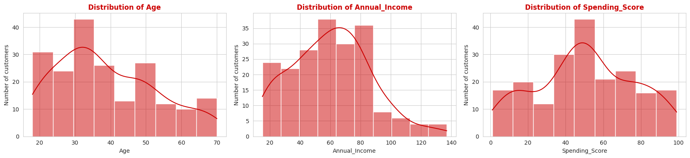

### Pairplot: relationships between the customer features

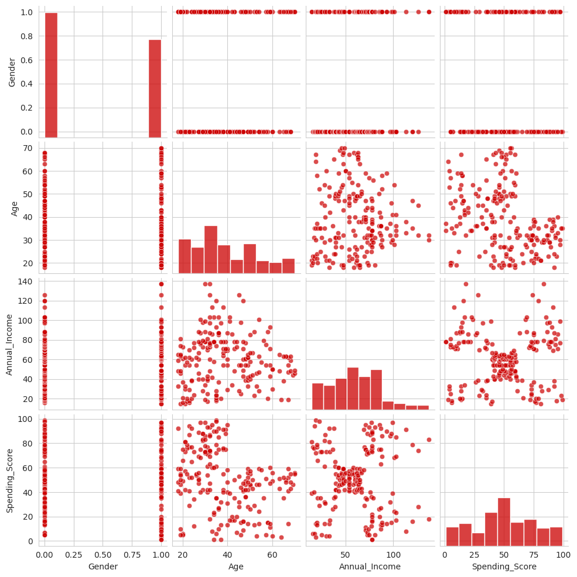

### Correlation heatmap: correlation values between numeric features

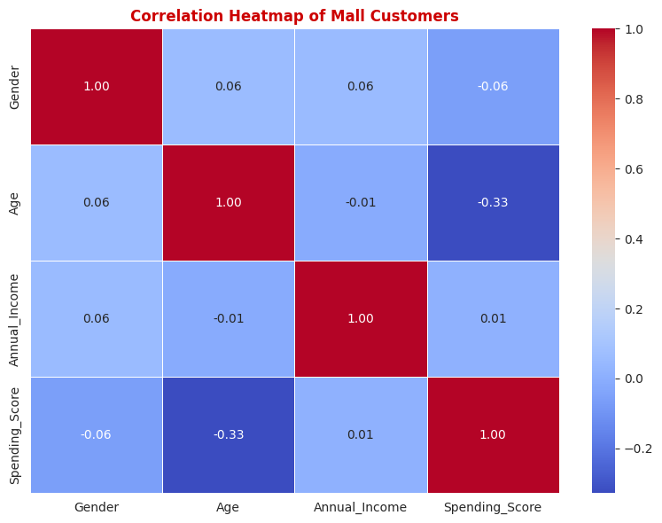

### K-Means elbow method: inertia for k from 1 to 10

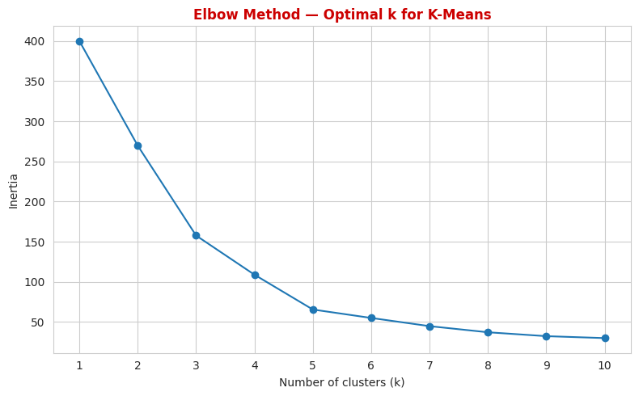

### K-Means silhouette scores for k from 2 to 10

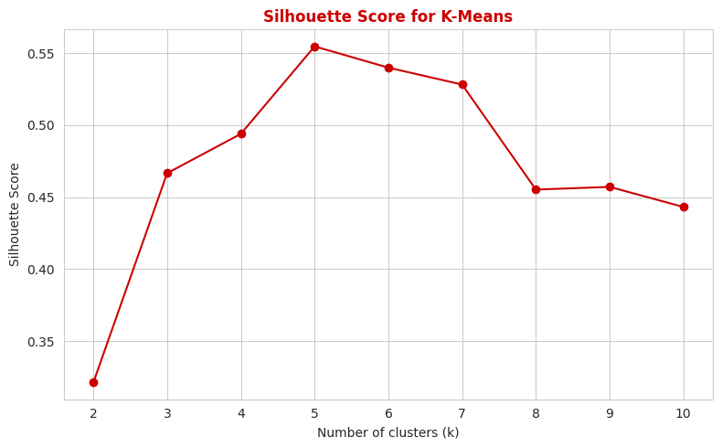

### K-Means customer segments with centroid markers

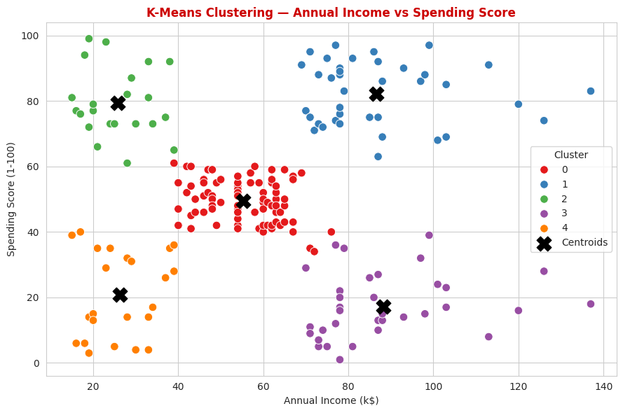

### Ward linkage dendrogram with suggested cut line

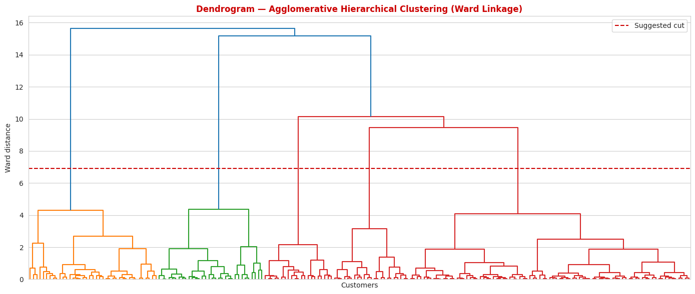

### Agglomerative hierarchical cluster visualisation

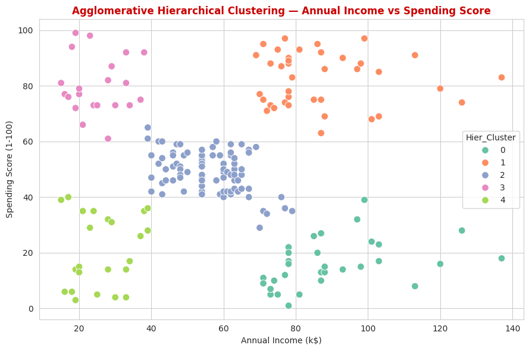

### Side-by-side K-Means and hierarchical comparison

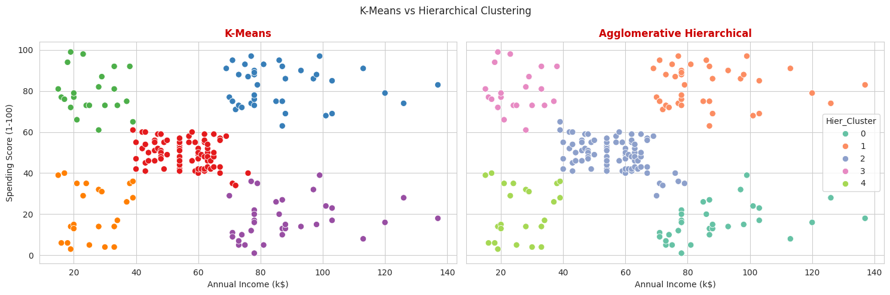

### 4-nearest-neighbour distance plot for DBSCAN epsilon tuning

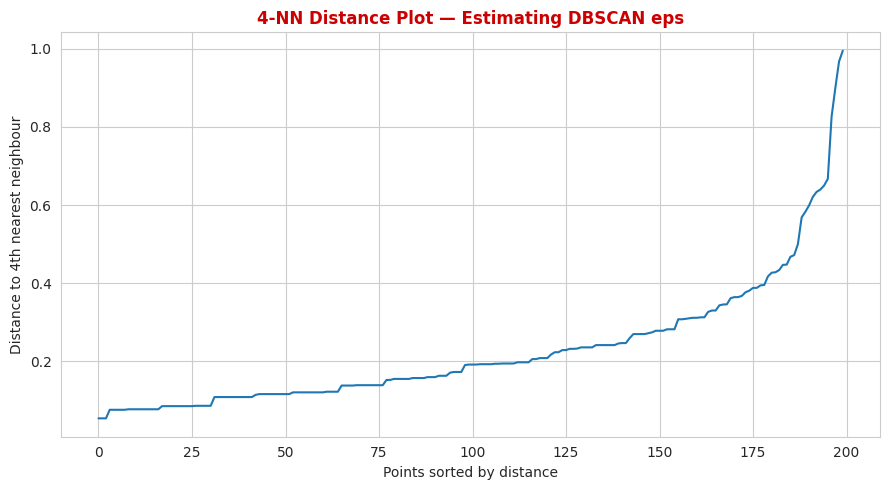

### DBSCAN customer segments with noise points marked

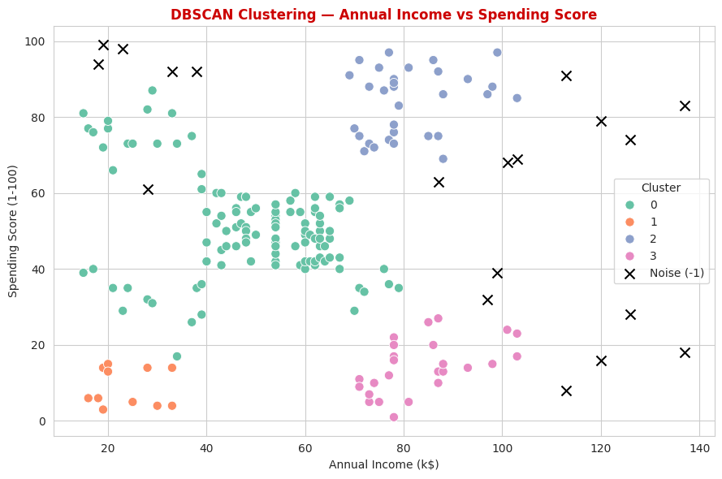

### Three-panel comparison of K-Means, Hierarchical and DBSCAN

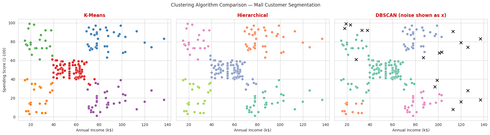
## Video
Add the URL of your 5–10 minute explanation video here: **[Paste video link]**

## Student details
Student name: ____________________  
Course / batch: ____________________
